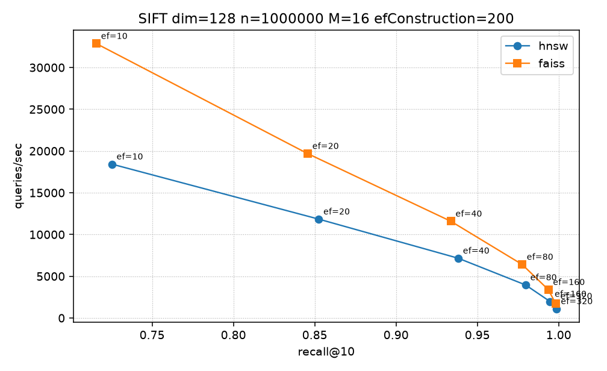

# hnsw-index

C++20 HNSW approximate nearest-neighbor index (Malkov and Yashunin, IEEE TPAMI 42(4), 2020). One public header, `hnsw/hnsw.hpp`. Distance kernels live in their own translation units.

## Graph

Layer 0 contains every live point and every tombstone. Its degree cap is `M0 = 2M`.
Layer `l > 0` contains occupants whose level is at least `l`. Its degree cap is `M`.
Insertion writes the forward edges, then a reverse edge at each selected neighbor. Reverse insertion reruns the same prune, so adjacency is not symmetric.
The entry point is an occupant of the current top layer. A new point replaces it only when its level is strictly greater. Equal levels keep the earlier point. Erase replaces it when that occupant is removed or the top layer loses every point. The replacement is an occupant of the new top layer, taken from the deleted node's former neighbors when one of them has that level. A tombstone still counts as an occupant.

## Layer assignment

Level is a function of `(seed, id)`. There is no RNG state.

```
m_L = 1 / ln(M)
h   = splitmix64(seed XOR (id * 0x9E3779B97F4A7C15))
u   = (h >> 11) * 2^(-53)          # [0, 1)
x   = max(1 - u, numeric_limits<double>::min())
L   = min(16, floor(-ln(x) * m_L))
```

`splitmix64` is the Steele mixer (`0x9E3779B97F4A7C15`, `0xBF58476D1CE4E5B9`, `0x94D049BB133111EB`). For uniform `u`, `P(L >= l) = M^(-l)`. The cap at 16 makes the upper tail slightly thinner. Uncapped, `E[L] = 1 / (M - 1)`.

## Neighbor selection

Paper Algorithm 4 with `extendCandidates = false` and `keepPrunedConnections = false`.

Candidates are sorted by increasing distance, then increasing id. Walk that order. Keep `e` when no already-kept neighbor `r` satisfies `dist(e, r) < dist(e, q)`. Squared L2 is monotone with L2, so the comparison is valid for the L2 metric. The forward list is that set, capped at `M0` on layer 0 and `M` above. Each selected id then receives `q` as a reverse neighbor. If the reverse list would exceed the cap, the same heuristic is run with that node as the origin.

No `prune_headroom`. FAISS 1.15.1 defaults `prune_headroom` to 0.2 and keeps `size_t(max_size - max_size * headroom)` neighbors (25 at layer 0 and 12 above, for `M = 16`), while `nb_neighbors` stays 32 and 16.

Search starts at the entry point. Layers `max_level .. 1` use beam 1. Layer 0 uses `min(n, max(ef, k))`. The candidate heap is a min-heap. The result heap is a max-heap of that beam width. A point enters when its distance is smaller than the worst result, or the distance is equal and its id is smaller. Expansion stops when the closest candidate distance is strictly greater than the worst result distance. A point is marked visited the first time it is seen. Returned ids are sorted by increasing distance, then increasing id, and truncated to `k`. `ef` or `k` above `10^7` is rejected.

| Metric | Minimized value | Storage |
| --- | --- | --- |
| L2 | squared L2 | raw floats |
| InnerProduct | negative dot product | raw floats |
| Cosine | negative dot product | L2-normalized on insert. The query is normalized into a search buffer. The distance kernel does not normalize. A zero vector is unchanged. |

## Complexity

For fixed `M` and `ef_construction`, the paper bounds expected construction by `O(N log N)` distance evaluations and expected search, at fixed `ef`, by `O(log N)`. The layer-0 beam grows with `ef`. This repository does not count distance evaluations. The measured quantities are build time, recall@10, and queries/sec.

## Memory layout

Vectors sit in chunks of 1024. `aligned_alloc(32, 1024 * dim * 4)` gives the base pointer. The byte count is a multiple of 4096. The stride is `dim` floats, with no padding. Each slot has an `atomic<uint8_t>` ready flag, release-stored after the bytes and any cosine normalization. Readers acquire-spin on that flag.

Nodes live in blocks of 256 and are never moved. Each node holds a `std::mutex`, its level, and pointers into a bump arena of `atomic<uint32_t>` (chunks of 65536). A node at level `L` owns `L + 1` seqlock counters, `L + 1` degrees, and `M0 + L * M` neighbor slots.

Id-to-node tables start at 32 pointers and id-to-chunk tables start at 4. Both double. Old tables are retained until destruction, so a published address stays valid. The `Node*` is release-stored after initialization. `n_` is release-stored after the ready flag and the node pointer when the id is fresh.

`size()` is the live count. `slot_count()` is `n_`, the high-water mark. Each node has an `atomic` slot state (`Empty`, `Live`, `Tombstone`, `Free`), a generation, and one inbound `std::vector<uint32_t>` per layer. Forward-list writers hold `graph_mu_`, and search does not read inbound lists. In-degree is uncapped. `memory_bytes()` sums vector chunks, the neighbor arena, node blocks, pointer tables, and inbound capacity. Erase does not return a chunk or an arena slice. The id goes on a freelist. The next insert reuses the node and its neighbor slots. Level is a function of `(seed, id)`, so the reused id keeps its level. `adopt_slot` throws if the stored level disagrees.

## SIMD distance kernels

`src/distance_avx2.cpp` is compiled with `-mavx2 -mfma` and is not in the public header. `distance_function` selects it at runtime when CPUID reports OSXSAVE, AVX, and FMA, `XCR0` has bits 1 and 2 (XMM and YMM), and leaf 7 EBX bit 5 (AVX2) is set. Otherwise the scalar loops in `src/distance_scalar.cpp` are used.

The AVX2 body keeps four YMM accumulators, steps 32 floats, then 8, then a scalar tail. The horizontal sum is extract plus the SSE add chain. The build does not pass fast-math flags. `l2_normalize` accumulates the sum of squares in double. Cosine and inner product share the negative-dot kernel.

## Concurrency

`insert` holds the allocator mutex across id allocation, the freelist pop, chunk and node growth, `memcpy`, cosine normalization, the ready release, node initialization, the live-count increment, and the `n_` release for a fresh id. The first occupant (`max_level < 0`) stores the entry and `max_level`, sets ready, and returns without linking. Every later insert links after that unlock.

`link_node`, `erase`, and `tombstone` hold `graph_mu_` for the whole structural edit. Concurrent inserts serialize there. Search does not take `graph_mu_`. Search is safe alongside insert, erase, tombstone, and other searches.

Entry promotion runs under `graph_mu_` and takes `entry_mu_` when `level > max_level`. It stores the entry relaxed, then `max_level` with release. Search loads `max_level` with acquire and the entry with acquire. Erase can replace the entry without changing `max_level`.

Each node mutex serializes writers of that node. Search does not take it. Neighbor lists are copied under a seqlock. The writer stores `seq = s + 1` relaxed, a release fence, the degree and slots relaxed, a release fence, then `seq = s + 2` with release. The odd value is the update window. The reader loads `seq` with acquire, spins while it is odd, copies degree and slots relaxed, an acquire fence, reloads `seq` relaxed, and retries unless the two sequence values match.

A thread holds at most one node mutex. It does not take the allocator mutex while holding `graph_mu_`. Erase drops `graph_mu_` before the reclaim mutex. Insert takes the allocator mutex, then the reclaim mutex.

Search publishes an epoch pin before it reads the graph. The pin stores the epoch clock and retries if the clock moved. `erase` records that clock, increments it, and moves the id to the freelist only after every active pin is strictly greater than the recorded epoch. A pin value of 0 means the slot is idle. There are 4096 pin slots. A freed id is not overwritten while a search that pinned before the unlink is still in `search`.

`insert_batch` with `threads == 1` assigns ids in row order. With `threads > 1`, ids follow allocator-lock order, not row order. The SIFT numbers below use `threads = 1`, so ids match the ground-truth file.

`save`, `load`, and destruction require exclusive access. `save` is not atomic with a concurrent insert.

Visited generation tags and both heaps are `thread_local`. On token wrap the tag array is cleared. `link_node` captures the node generation under `graph_mu_` and returns without writing edges if `erase` has already bumped it.

## On-disk format

Little-endian. Magic `HNSW0001`. `save` writes version `u32 = 2`. `load` still accepts version 1.

Version 1 is dense. Its count field is `n`, every id in `[0, n)` is live, and there is no flag array.

Version 2 stores the high-water mark and a hole map.

| Field | Type |
| --- | --- |
| magic | 8 bytes |
| version | u32, `2` |
| dim, metric, M, M0, ef_construction | u32 |
| seed | u64 |
| high-water | u32 |
| max_level | i32, `-1` when no occupant remains |
| entry_point | u32, `0` when empty |
| flags | u8[high-water], `0` free, `1` live, `2` tombstone |
| vectors | f32[dim] for each occupied id, ascending id, stored form |
| levels | u32 per occupied id, same order |
| links | for each occupied id, for layer `0 .. level`: u32 degree, then that many u32 neighbor ids |

Load rejects a file unless `M0 == 2M`, levels are in `[0, 16]`, the entry level equals `max_level` and equals the maximum stored level, every degree is within the layer cap, and every neighbor id is below the high-water mark, is not the node itself, and has level at least the layer. An empty file must have `max_level == -1` and `entry == 0`. Free ids are pushed on the freelist with no epoch wait. A little-endian host bulk-copies the floats. Any other host writes each float as its `u32` bit pattern.

## Build and run

```
cmake -S . -B build -DCMAKE_BUILD_TYPE=Release
cmake --build build -j
ctest --test-dir build --output-on-failure
```

CMake options: `HNSW_BUILD_TESTS`, `HNSW_BUILD_BENCH`, `HNSW_ENABLE_AVX2`, `HNSW_ENABLE_ASAN`, `HNSW_ENABLE_UBSAN`, `HNSW_ENABLE_TSAN`, `HNSW_WERROR`. TSan cannot be combined with ASan or UBSan. Sanitizer flags are applied before the GoogleTest fetch so the test library is instrumented.

```
bash bench/fetch_sift.sh
./build/hnsw_bench \
  --base data/sift/sift_base.fvecs \
  --query data/sift/sift_query.fvecs \
  --gt data/sift/sift_groundtruth.ivecs \
  --M 16 --ef-construction 200 --k 10 \
  --efs 10,20,40,80,160,320 --threads 1 --gt-check 16 \
  --csv bench/results/hnsw.csv \
  --meta bench/results/hnsw_meta.txt
python3 bench/compare_faiss.py \
  --base data/sift/sift_base.fvecs \
  --query data/sift/sift_query.fvecs \
  --gt data/sift/sift_groundtruth.ivecs \
  --hnsw-bin ./build/hnsw_bench \
  --hnsw-csv bench/results/hnsw.csv --skip-hnsw \
  --out-csv bench/results/results.csv \
  --plot bench/results/recall_qps.png \
  --meta bench/results/meta.txt \
  --M 16 --ef-construction 200 --k 10 \
  --efs 10,20,40,80,160,320
```

```
./build/hnsw_delete_bench \
  --base data/sift/sift_base.fvecs \
  --query data/sift/sift_query.fvecs \
  --M 16 --ef-construction 200 --k 10 \
  --efs 10,40,160 --fractions 0.1,0.3,0.5 --churn 0.1 \
  --max-n 20000 --max-q 1000 --seed 1 \
  --csv bench/results/delete.csv \
  --meta bench/results/delete_meta.txt
```

`fetch_sift.sh` tries the TEXMEX tarball, then `sift-128-euclidean.hdf5` from ann-benchmarks. The measured files came from that HDF5 fallback. Python packages for the comparison: `numpy`, `faiss-cpu`, `matplotlib`. `h5py` is used only by the HDF5 conversion. Datasets are gitignored.

```cpp
hnsw::Params params;
params.M = 16;
params.ef_construction = 32;
params.metric = hnsw::Metric::L2;
params.seed = 1;

hnsw::Index index(2, params);
const float points[] = {0.f, 0.f, 1.f, 0.f, 0.f, 1.f};
index.insert_batch(points, 3, 1);

const float query[] = {0.1f, 0.9f};
const std::vector<hnsw::Neighbor> hits = index.search(query, 1, 16);
```

`Neighbor::distance` is the minimized value from the metric table. `BruteForce` is an exact scan with the same metric and the same sort order. `BruteForce::erase` marks the slot dead and does not move later ids. `size()` is the live count. It is not safe for concurrent `add` and `search`.

## Deletion

`erase` accepts a live id or a tombstone. It holds `graph_mu_` until the graph is repaired.

It snapshots the out-neighbors and the in-neighbors on every layer the node occupies, adds one to the generation, and stores `Free`. A live id decrements `size()`. `level_count[level]` decrements for both. From the node's level down to layer 0 it clears that node's forward list, then walks the snapshotted in-neighbors. Each in-neighbor drops the deleted id. A non-live in-neighbor keeps the rest of its list and is not re-selected. A live in-neighbor `u` builds a candidate bag from three sets, plus a local search: its remaining forward list, the deleted node's out-neighbors on that layer, the deleted node's in-neighbors on that layer, and `search_layer` from `u` with width `ef_construction`. The bag drops `u`, the deleted id, and any id that is not live. `select_from` is Algorithm 4 with the layer cap. `write_links` publishes that list and updates inbound records.

`level_count` includes tombstones. The new top layer is the highest bin that is still non-zero. If every bin is zero, `max_level` becomes `-1`, the entry becomes `0`, and ready is cleared, so the next insert is a fresh entry point. Otherwise the current entry is kept when it still occupies that layer. If it does not, the replacement is the first former neighbor of the deleted node that occupies the new top layer, or a scan of `[0, slot_count())` if none does.

After `graph_mu_` is released the id is retired under the epoch rule in Concurrency. The freelist hands it to a later `insert`. The neighbor arena slice is reused with the id.

## Tombstones

`tombstone` stores `Tombstone`, decrements the live count, and leaves the vector and the edges in place. `level_count` does not change, so the point can remain the entry. The slot is not reused. Search pushes a tombstone onto the candidate heap and does not admit it to the result beam, so a tombstone does not consume `ef`. Returned ids are live.

The vector chunk, the neighbor slots, and the inbound lists stay allocated. `slot_count()` does not shrink. The next insert of a distinct vector takes a fresh id, so delete/insert churn grows the high-water mark by one slot per insert. Search still evaluates a distance for every tombstone it visits, and live lists still name deleted ids. The neighbor heuristic is not rerun on the surviving graph.

FAISS HNSW does not implement `remove_ids`. On facebookresearch/faiss#3339 the maintainer wrote that HNSW does not support `remove_ids`, because the graph has to be re-linked after nodes are removed.

A filter applied only after the beam is full would spend `ef` on dead hits and cut recall. This tombstone path does not do that. In the measurements below, tombstone recall stays above erase recall, and tombstone QPS falls as the dead fraction grows. Slot reuse is the part a tombstone does not do.

## Benchmark

SIFT1M, 128 dimensions, L2. `n = 1000000`, `nq = 10000`, `k = 10`, `M = 16`, `M0 = 32`, `ef_construction = 200`, one thread. The timer covers index construction only. Each `ef` gets one untimed pass over the query set, then one timed pass. QPS is `nq / elapsed`. recall@10 is the fraction of returned ids that appear in the exact top 10. The ground-truth file stores 100 neighbors per query. The first 10 are used. Before the timed build, brute force on 16 base vectors matched that file with 0 id mismatches. `max_level` on this build was 5.

FAISS 1.15.1 `IndexHNSWFlat(dim, M, METRIC_L2)`, `efConstruction = 200` (the library default is 40), `faiss.omp_set_num_threads(1)`. Same warmup protocol. `nb_neighbors(0) = 32`, `nb_neighbors(1) = 16`, `prune_headroom = 0.2`.

Hardware: KVM guest, `Intel(R) Xeon(R) Processor`, family 6, model 207, stepping 2, 4 CPUs, 1 thread per core, 4 cores, 1 socket. L1d 48 KiB x4, L1i 32 KiB x4, L2 2 MiB x4, L3 320 MiB. `MemTotal: 16387280 kB`. Little endian. `g++ (Ubuntu 13.3.0-6ubuntu2~24.04.1) 13.3.0`, AVX2 kernel selected. Python 3.12.3.

| ef | recall@10 | QPS | FAISS recall@10 | FAISS QPS |
| ---: | ---: | ---: | ---: | ---: |
| 10 | 0.725260 | 18427.403 | 0.715710 | 32858.865 |
| 20 | 0.852450 | 11840.606 | 0.845650 | 19684.899 |
| 40 | 0.938250 | 7155.478 | 0.933700 | 11583.562 |
| 80 | 0.979680 | 3954.953 | 0.977500 | 6415.000 |
| 160 | 0.994650 | 1978.563 | 0.993620 | 3393.862 |
| 320 | 0.998440 | 1102.587 | 0.998170 | 1720.874 |

Build time: this index 468.656 s, FAISS 355.850 s. One run. Cosine and inner product are implemented and covered by the unit tests. The table is L2 only.



CSV: `bench/results/results.csv`.

### Deletion on a SIFT prefix

Same machine and compiler as the SIFT1M run. AVX2 kernel selected. `delete_meta.txt` records `cpu_model Intel(R) Xeon(R) Processor`, `MemTotal: 16387280 kB`, compiler `13.3.0`, `avx2 1`.

Prefix of `sift_base.fvecs`, `n = 20000`, first `nq = 1000` queries, dim 128, L2. `M = 16`, `M0 = 32`, `ef_construction = 200`, `k = 10`, `seed = 1`, one thread. The deleted ids are a `std::mt19937` shuffle of `[0, n)` seeded with `1`. Fraction `f` removes the first `floor(f * n)` ids of that permutation: 2000, 6000, and 10000. Churn is 2000 steps. Each step removes `order[i]` and inserts `base[n + i]`.

Three strategies, each on a fresh build. `erase` calls `Index::erase`. `tombstone` calls `Index::tombstone`. `rebuild` for a fraction builds one index from the survivors in increasing original-id order. `rebuild` for churn builds one index from those survivors followed by the 2000 inserted vectors. It is one construction, not a rebuild per step. Rebuild ids are that insertion order. Ground truth is an exact squared-L2 top 10 over the same ids, closer first, then smaller id.

`op_seconds` times only the deletes, the churn loop, or the rebuild `insert_batch`. Each `ef` has one untimed query pass and one timed pass. QPS is `nq / elapsed`. `memory_bytes` is `Index::memory_bytes` after the mutation. Process RSS is not in the table. It includes the mapped fvecs and pages the allocator has not returned, and it climbs across rows inside one process. One run.

| phase | fraction | strategy | ef | recall@10 | QPS |
| --- | ---: | --- | ---: | ---: | ---: |
| delete | 0.1 | erase | 10 | 0.828200 | 83903.098 |
| delete | 0.1 | erase | 40 | 0.985600 | 28787.031 |
| delete | 0.1 | erase | 160 | 0.999800 | 8490.015 |
| delete | 0.1 | tombstone | 10 | 0.864500 | 66024.783 |
| delete | 0.1 | tombstone | 40 | 0.991400 | 22544.899 |
| delete | 0.1 | tombstone | 160 | 0.999900 | 6861.636 |
| delete | 0.1 | rebuild | 10 | 0.857800 | 74140.191 |
| delete | 0.1 | rebuild | 40 | 0.990300 | 25264.820 |
| delete | 0.1 | rebuild | 160 | 0.999900 | 7638.902 |
| delete | 0.3 | erase | 10 | 0.832700 | 86427.383 |
| delete | 0.3 | erase | 40 | 0.985200 | 29106.836 |
| delete | 0.3 | erase | 160 | 0.999800 | 8707.607 |
| delete | 0.3 | tombstone | 10 | 0.890900 | 51950.033 |
| delete | 0.3 | tombstone | 40 | 0.994600 | 17811.244 |
| delete | 0.3 | tombstone | 160 | 0.999900 | 5499.602 |
| delete | 0.3 | rebuild | 10 | 0.868200 | 81907.910 |
| delete | 0.3 | rebuild | 40 | 0.991600 | 27360.158 |
| delete | 0.3 | rebuild | 160 | 0.999900 | 8288.975 |
| delete | 0.5 | erase | 10 | 0.839700 | 91269.373 |
| delete | 0.5 | erase | 40 | 0.986700 | 30502.679 |
| delete | 0.5 | erase | 160 | 0.999800 | 9146.893 |
| delete | 0.5 | tombstone | 10 | 0.920200 | 37884.516 |
| delete | 0.5 | tombstone | 40 | 0.997300 | 12899.348 |
| delete | 0.5 | tombstone | 160 | 0.999900 | 3979.760 |
| delete | 0.5 | rebuild | 10 | 0.878800 | 92002.795 |
| delete | 0.5 | rebuild | 40 | 0.993600 | 30853.907 |
| delete | 0.5 | rebuild | 160 | 0.999800 | 9354.645 |
| churn | 0.1 | erase | 10 | 0.830800 | 79730.327 |
| churn | 0.1 | erase | 40 | 0.985600 | 27119.019 |
| churn | 0.1 | erase | 160 | 0.999600 | 8028.923 |
| churn | 0.1 | tombstone | 10 | 0.858300 | 63559.905 |
| churn | 0.1 | tombstone | 40 | 0.989900 | 21888.186 |
| churn | 0.1 | tombstone | 160 | 0.999800 | 6097.509 |
| churn | 0.1 | rebuild | 10 | 0.854500 | 70350.698 |
| churn | 0.1 | rebuild | 40 | 0.988800 | 24256.903 |
| churn | 0.1 | rebuild | 160 | 0.999700 | 7338.742 |

| phase | fraction | strategy | op_seconds | op_count | memory_bytes | n_live | n_slots |
| --- | ---: | --- | ---: | ---: | ---: | ---: | ---: |
| delete | 0.1 | erase | 5.168310 | 2000 | 18420840 | 18000 | 20000 |
| delete | 0.1 | tombstone | 0.000049 | 2000 | 18335552 | 18000 | 20000 |
| delete | 0.1 | rebuild | 2.503989 | 2000 | 16566200 | 18000 | 18000 |
| delete | 0.3 | erase | 13.526486 | 6000 | 18453832 | 14000 | 20000 |
| delete | 0.3 | tombstone | 0.000107 | 6000 | 18335552 | 14000 | 20000 |
| delete | 0.3 | rebuild | 1.799663 | 6000 | 12777664 | 14000 | 14000 |
| delete | 0.5 | erase | 21.315574 | 10000 | 18475496 | 10000 | 20000 |
| delete | 0.5 | tombstone | 0.000161 | 10000 | 18335552 | 10000 | 20000 |
| delete | 0.5 | rebuild | 1.175314 | 10000 | 9277976 | 10000 | 10000 |
| churn | 0.1 | erase | 5.804187 | 4000 | 18475048 | 20000 | 20000 |
| churn | 0.1 | tombstone | 0.418575 | 4000 | 20098632 | 20000 | 22000 |
| churn | 0.1 | rebuild | 2.900171 | 4000 | 18354760 | 20000 | 20000 |

Erase latency per id is `op_seconds / op_count` on the delete rows: 2.584 ms, 2.254 ms, and 2.132 ms. Each live in-neighbor runs `search_layer` at `ef_construction` while `graph_mu_` is held. Tombstone latency is the state store. At fraction 0.5 and `ef = 10`, tombstone QPS is 37884.516 against 91269.373 for erase and 92002.795 for rebuild. After the pure deletes, erase `memory_bytes` stays on the 20000-slot allocation. Rebuild `memory_bytes` follows the live count. After churn, erase `n_slots` is 20000 and tombstone `n_slots` is 22000.

At `ef = 10`, erase recall is below a rebuilt graph (0.828200 against 0.857800 at fraction 0.1, 0.839700 against 0.878800 at fraction 0.5). At `ef = 160` the three strategies sit between 0.999600 and 0.999900. Tombstone recall is the highest of the three at `ef = 10` because dead nodes stay on the candidate heap and do not take result slots.

CSV: `bench/results/delete.csv`.
